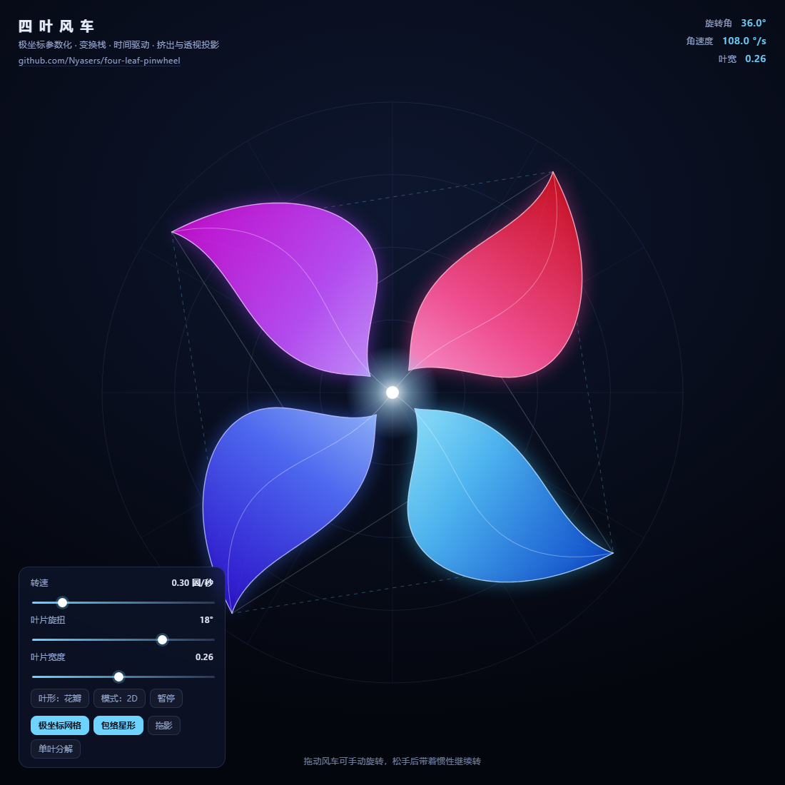

# four-leaf-pinwheel

四叶风车。一个把计算机图形学入门那条流水线走完的小实验：**几何描述 → 坐标变换 → 时间驱动 → 投影消隐**。

用极坐标参数化写出一片叶子，用变换栈复制成四片，用每帧的时间差推动它旋转，最后沿 Z 轴挤出厚度、做透视投影、按深度排序决定遮挡。做它不是为了画出一张好看的图，而是为了把课本上那些抽象的公式落成屏幕上能看见、能摸、能拧的东西。

单页 Canvas 2D，无框架、无运行时依赖，Vite + TypeScript。

> 本项目位于 [toys](../../README.md) 仓库的 `packages/four-leaf-pinwheel/` 子目录，线上地址是 <https://nyasers.github.io/toys/four-leaf-pinwheel/>。安装与构建走仓库根的 pnpm workspace，下面这些命令在仓库根执行。



## 用法

```
pnpm install
pnpm dev                       开发（热更新）
pnpm build                     dist/：多文件，不压缩
pnpm build:minify              dist/：多文件，压缩
pnpm build:standalone          dist/index.html：单文件，不压缩
pnpm build:standalone:minify   dist/index.html：单文件，压缩
```

两种构建都落在 `dist`，每次都清空重建。自包含版外部引用为 0，可以直接双击打开。

## 它能做什么

- **拖动风车手动旋转**，松手后带着惯性继续转，速度按指数衰减
- **调转速、叶片旋扭、叶片宽度、视角俯仰**（四个滑块，实时生效）
- **三种叶形**：花瓣 / 帆形 / 刀片，共用同一份顶点生成代码，只换一个宽度分布函数
- **2D / 3D 双模式**：3D 把叶片沿 Z 轴挤出厚度，做透视投影，再按深度排序决定遮挡
- **参考层**：极坐标网格、四叶尖连成的正方形包络、内外半径交替的星形
- **单叶分解视图**：把一片叶子单独拆开，看清中轴曲线与宽度剖面是怎么长出来的
- **拖影模式**：不彻底擦除画布，让上一帧的残影留下来

## 它练的是什么

一个四叶风车拆开看，是四个问题叠在一起。

**一片叶子长什么样**，是几何描述问题。我没有手工描点，而是用极坐标写出叶片的中轴：

```
r(t) = L · (0.10 + 0.90 · t^0.95)    径向伸出去
φ(t) = β · sin(πt)                    沿角向甩出去，β 就是「旋扭」旋钮
```

再给它加宽度。在每一个 `t` 处，叶子的半宽是 `w(t)`，外缘走 `φ + Δ`，内缘走 `φ - Δ`：

```
w(t) = L · h_w · sin(πt)^1.05
Δ(t) = w(t) / r(t)                    ← 关键在这一个除法
```

外缘正着走一遍、内缘倒着走回来，首尾自动收拢成两个尖，得到一条闭合的叶子轮廓。

**为什么是四片，而不是一片画四遍**，是变换问题。四片叶子形状完全相同，只各自转过了 0°/90°/180°/270°。所以代码里只存一份顶点，靠旋转坐标系复制：

```ts
for (let i = 0; i < BLADE_COUNT; i++) {
  ctx.save();
  // 变换栈：只转坐标系，outline 的顶点一个都没改
  ctx.rotate(angle + (i * Math.PI) / 2);
  this.trace(outline);
  ctx.restore();
}
```

**怎么让它动起来**，是时间问题。每帧拿到和上一帧的时间差 `dt`，累加角度。用 `dt` 而不是「每帧固定加一点」，是因为帧率会变。

**怎么让它看着是立体的**，是投影问题。给平面图形沿 Z 轴拉出厚度，切成 18 层切片，投影到屏幕：

```ts
const k = focal / (focal + Z);   // 透视除法：越远越小
```

投影完还要回答「谁盖住谁」。Canvas 2D 没有深度缓冲，所以把所有切片按平均深度从远到近排序，远的先画。这叫画家算法。

## 踩过的坑

这些是真实返工过的地方，不是「一切顺利」的装饰。

**叶子胖成了四叶草。** 第一版把宽度定义成「角宽度」，结果根部很细、越往外越胖。原因是角宽 ≠ 物理宽度：在半径 `r` 处张角 `δ`，实际弧长是 `r·δ`，半径一大物理宽度就爆了。修法就是上面那个 `Δ = w / r`。

**拖拽时风车会突然跳半圈。** `Math.atan2()` 的值域是 `(-π, π]`，鼠标穿过正左方时角度从 `+π` 跳到 `-π`，算出来的角度差一下子是 `-2π`。修法是把角度差归一化回 `(-π, π]`。

**切回标签页时风车疯转。** 浏览器在标签页不可见时会暂停 `requestAnimationFrame`，回来时 `dt` 变成几十秒。修法是给 `dt` 设上限。

**惯性衰减和帧率绑定了。** 第一版写成每帧乘 0.96，在 60Hz 和 144Hz 屏幕上手感完全不同。改成 `Math.pow(0.06, dt)`，让衰减和时间挂钩而不是和帧数挂钩。

**3D 描边把画面搞脏了。** 一开始给每层切片都描边，18 层叠起来全是毛刺。后来只给最前面那一层描边。

**`hidden` 挡不住自己写的 `display`。** 错误提示层用 `hidden` 属性隐藏，但 CSS 里给它写了 `display: grid` —— 作者样式盖过 UA 样式，遮罩于是永远盖在画布上。修法是补一条 `.fatal[hidden] { display: none }`。

## 形态

```
index.html           DOM 契约：控件 id、读数位置、错误提示层
src/main.ts          装配与主循环，唯一的 rAF 起点
src/geometry.ts      叶片的参数化（纯计算，不碰 DOM）
src/scene.ts         三种画法：2D 变换栈 / 3D 挤出投影 / 单叶分解
src/palette.ts       色相与渐变
src/model.ts         状态与时间推进
src/ui.ts            DOM 契约的读写
src/styles.css       界面样式
vite.config.ts       四种构建变体 + 单文件内联
```

`geometry.ts` 与 `model.ts` 不接触 DOM，`scene.ts` 只认识 Canvas 与 `SceneParams`，DOM 的存在被收在 `ui.ts` 与 `main.ts`。

## License

Mozilla Public License 2.0，全仓库共用一份，全文见 [LICENSE](../../LICENSE)。简单说：你可以随意使用、修改、再分发这个项目，甚至放进商业产品；但如果你改了这个项目的源文件，那些文件的修改版必须以 MPL 2.0 继续开源。你自己新写的文件不受约束。

## 一点想法

做完之后盯着屏幕看了挺久。它其实很简单，四片花瓣转圈而已。但我知道每一片花瓣的位置是怎么来的：一条正弦曲线决定它甩出去多少，一个除法决定它多宽，一个旋转矩阵决定它朝哪边，一次透视除法决定它看起来多大，一次排序决定它被谁盖住。

我原来以为图形学的难点在数学，做完发现数学反倒是干净的，真正麻烦的是那些工程细节：角度会跳变，帧率会变，深度会丢，边界会穿。这些细节在课本里通常是一句「注意处理」带过，但在代码里它们就是全部。
